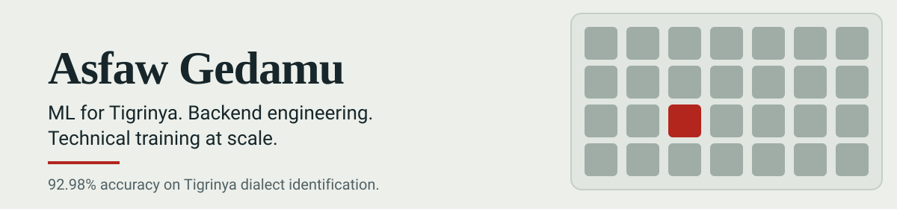

<!-- 

  

  -->

# 🖐️ Hi, I'm Asfaw Gedamu

**Enterprise Tech Learning Strategist | Senior ML Engineer | Backend Architect**

#

  

#

Senior Systems & AI Specialist with **19+ years of experience** at **Ethio Telecom**. I specialize in low-resource NLP research, production-grade backend architecture, and technical workforce development (upskilled **500+ professionals** in AI, ML, Cybersecurity, and FinTech).

---

## Strategic Value & Technical Impact

* **Low-Resource NLP Research:** Published author of the first annotated Tigrinya dialect-identification benchmark. Designed a character-level CNN architecture achieving **92.98% accuracy**.

  
* **Enterprise Backend Engineering:** Architect of production-grade, modular FastAPI/SQL systems focusing on security (JWT/OAuth2), test-driven development (Pytest), and scalability.

  
* **Technical Upskilling & Strategy:** Enterprise Curriculum Architect since 2021, leading hands-on capacity building across cyber security, cloud computing, FinTech, machine learning, and telecom billing tracks.

---

## Core Competencies & Technical Stack

| Domain | Key Technologies & Frameworks | Evidence / Implementation |
| :--- | :--- | :--- |
| **Machine Learning & NLP** | Python, PyTorch, TensorFlow, Pandas, NumPy, Scikit-Learn | [Tigrinya Dialect ID Benchmarks](https://github.com/asfawgedamu/Tigrinya-Dialect-Identification) |
| **Backend Architecture** | FastAPI, Pydantic v2, SQLAlchemy, RESTful APIs, JWT, Pytest, HTTPX | [API Design Lab Series](https://github.com/asfawgedamu/api-design-fundamentals) |
| **Database & Data Infra** | PostgreSQL, Oracle, SQL Server, MySQL, SQLite, Data Modeling | [Database Systems Reference](https://github.com/asfawgedamu/database) |
| **DevOps & Environments** | Linux (RHEL/Ubuntu), Docker, Git/GitHub CI/CD, VS Code | Enterprise Lab Infrastructure |

---

## Featured Open-Source Projects

| Project | Description & Impact | Tech Stack |
| :--- | :--- | :--- |
| [**Tigrinya Dialect Identification**](https://github.com/asfawgedamu/Tigrinya-Dialect-Identification) | Dataset of 2,964 annotated sentences across three dialects (L, Z, D). Implemented baseline ML & deep learning architectures, reaching **92.98% accuracy** with character-level CNNs. |    |
| [**API Design Fundamentals**](https://github.com/asfawgedamu/api-design-fundamentals) | Enterprise, 3-level progressive FastAPI lab framework. Covers CRUD operations, Pydantic v2 validation, JWT authentication, modular layered architecture, and unit/integration testing with Pytest. |     |
| [**Database Systems Reference**](https://github.com/asfawgedamu/database) | Production DBA reference kit containing 15 monitoring & query optimization scripts, schema normalization guidelines, and cross-platform benchmarks. |    |

---

## Peer-Reviewed Publications

* **Tigrinya Dialect Identification**  
  *Asfaw Gedamu Haileslasie, Asmelash Teka Hadgu, Solomon Teferra Abate*  
  📄 Published on OpenReview: [Read Full Paper & Benchmark](https://openreview.net/forum?id=kiG8qiUFm2u)

---

- **Open to:** Senior ML / Backend Engineering Roles, Research Collaboration, and Enterprise Workforce Development.

### Let's Connect

#

  
